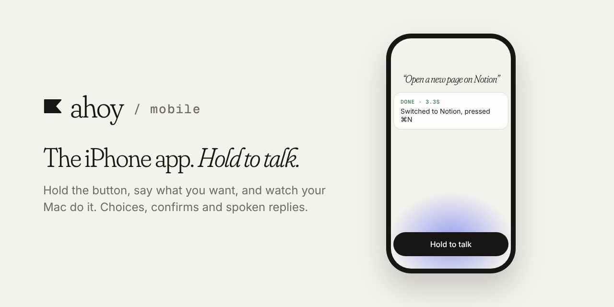

**Ahoy** is a voice assistant that lets you control your Mac from your phone. This repo is the phone app.

[▶ Watch the 1:45 demo](https://drive.google.com/file/d/1JMgSd2bm7LtUCs2WxiTNWuo0-bijqs4p/view?usp=sharing) · [All Ahoy repos](https://github.com/getahoy)

# Ahoy mobile

Expo app for iOS and Android: sign in, then talk to your Mac.

## What it does

- **Pair with your Mac** by scanning the QR code the Mac app shows.
- **Hold to talk.** It only listens while you hold the button, then sends your words to your Mac.
- **Shows what happened**, with a short "Done" card for every command.
- **Asks when it isn't sure.** If two things match, a "Which one?" sheet lets you say or tap the number.
- **Confirms risky actions** like deleting or sending, by tap only.
- **Talks back** with short spoken replies, on the phone or the Mac.

## Setup

```bash
pnpm install
cp .env.example .env.local
npx expo run:ios
```

`EXPO_PUBLIC_API_URL` points at the `web` server. `@getahoy/lib` comes from
`../shared/packages/lib`; run `pnpm build` there first.

This is a development build, not Expo Go. After adding a native module, run
`npx expo run:ios` again.

## Fonts and splash wordmark

`assets/fonts/` holds static cuts made from the Google Fonts variable sources:
Fraunces (opsz 72, SOFT 100, WONK 1, at weights 300 and 400, upright and
italic, as `FrauncesAhoy-*`), Inter 400 and 500, and Geist Mono 500. The same
script renders the splash wordmark (`assets/images/splashWordmark*.png`, 1x to
3x, light and dark) and the pennant mark (`assets/images/pennant*.png`, an
alpha mask tinted in the app). Rebuild them all with:

```bash
uv run --no-project --with fonttools --with pillow python scripts/buildBrandAssets.py
```

All three families are licensed under the SIL Open Font License 1.1, which
allows bundling and modified versions; the licence texts are in
`assets/fonts/ofl/`. The fonts are embedded at build time by the `expo-font`
config plugin, so a font change needs a native rebuild.

## Component gallery

Dev builds only: shake the phone (or press Cmd+D in the simulator) and choose
Component gallery in the Expo developer menu. Every UI primitive in every
state, with a dark mode switch and the build stamp. Release builds cannot
reach it.

## Scripts

| Script | Does |
|---|---|
| `pnpm start` | Metro for the development build |
| `pnpm typecheck` | `tsc` |
| `pnpm lint` | `expo lint` |
